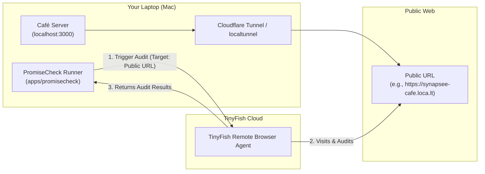

# synapsee-promisecheck

A monorepo orchestrating the **Synapsee Café** web application and the **PromiseCheck** AI verification engine powered by TinyFish web agents.

---

## 📁 Repository Structure

```text
synapsee-promisecheck/
  apps/
    cafe/
    promisecheck/
  integration/
  README.md
```

- **`apps/cafe/`**: The customer-facing café web application displaying menu items, store hours, dietary options, and customer promises.
- **`apps/promisecheck/`**: The verification engine running locally on your laptop that instructs TinyFish's remote web agent to audit the café's public website.
- **`integration/`**: End-to-end integration test harness, test specifications, and audit contracts.
- **`README.md`**: Master repository documentation, architecture overview, and team operating rules.

---

## 👥 Ownership & Access Boundaries

To maintain strict boundaries between components and AI models working on the codebase:

| Component | Owner / AI Agent | Access Scope |
| :--- | :--- | :--- |
| **`apps/cafe/`** | **Gemini** & Neha | **Exclusive access to `apps/cafe/` only.** Gemini must not modify files outside this directory. |
| **`apps/promisecheck/`** | **Codex** & Jeevith | **Responsible for `apps/promisecheck/`.** Codex develops the local verification engine and TinyFish client. |
| **`integration/`** | **Likitha & Repo Owner** | Owns cross-component integration test specifications, verification suites, and E2E workflows. |
| **`README.md` & Root Config** | **Repo Owner** | Governs global architecture, GitHub workflows, and repository policies. |

*(Enforced via `.github/CODEOWNERS` and `.github/workflows/boundary-check.yml`)*.

---

## 🌿 Distributed Team & Branch Strategy

When developing across separate computers, team members work on dedicated feature branches:

| Team Member | Branch | Scope | Description |
| :--- | :--- | :--- | :--- |
| **Neha** | `feature/cafe` | `apps/cafe/` | Café website development, menu design, and public tunnel/hosting setup. |
| **Jeevith** | `feature/promisecheck` | `apps/promisecheck/` | PromiseCheck local runner, TinyFish agent orchestration, and evaluation rules. |
| **Likitha** | `test/integration` | `integration/` | Integration assertions, audit contracts, and black-box E2E test verification. |

### Branch Synchronization Workflow
```bash
# Neha (Café)
git checkout feature/cafe
git pull origin feature/cafe

# Jeevith (PromiseCheck)
git checkout feature/promisecheck
git pull origin feature/promisecheck

# Likitha (Integration)
git checkout test/integration
git pull origin test/integration
```

---

## 🌐 TinyFish Reachability & Deployment Architecture

### The Localhost Limitation
> [!IMPORTANT]
> **Why `localhost` cannot be used:**
> TinyFish operates cloud-hosted autonomous browser agents. When TinyFish navigates to a URL, its browser runs in a remote datacenter.
> A URL like `http://localhost:3000` or `http://127.0.0.1:3000` on your Mac resolves only inside your computer's local network loopback. TinyFish's remote browser cannot connect to your laptop's localhost.



### 1. Making the Café Publicly Reachable
When running locally during development, expose `apps/cafe` through a secure public tunnel:

```bash
# Option A: Built-in localtunnel (Zero config required)
cd apps/cafe
npm run tunnel

# Option B: Cloudflare Tunnel (Zero config, fast)
npx cloudflared tunnel --url http://localhost:3000

# Option C: ngrok
ngrok http 3000
```

Alternatively, deploy `apps/cafe` to **Vercel**, **Netlify**, or **Cloudflare Pages** for a persistent public URL.

### 2. Running PromiseCheck Locally
PromiseCheck runs on your laptop and does not require a public IP:
```bash
cd apps/promisecheck
cp .env.example .env
# Set CAFE_PUBLIC_URL to your public café URL (e.g. from the tunnel)
npm install
npm run check
```

---

## 🔌 Zero-Coupling Integration Boundary

The two applications are deliberately decoupled:
- **No Shared Database**: Café and PromiseCheck maintain independent or zero persistence.
- **No Direct Internal APIs**: PromiseCheck does not invoke internal café routes or privileged endpoints.
- **Black-Box Audit Model**: PromiseCheck audits the Café purely through external web observation via TinyFish (reading DOM, evaluating promises, verifying visible claims against expectation contracts).

---

## 🚀 Quick Start Guide

### 1. Start the Café (Publicly Expose)
```bash
cd apps/cafe
npm install
npm start          # Runs on http://localhost:3000
# In a second terminal:
npm run tunnel     # Generates a public HTTPS URL for TinyFish
```

### 2. Run PromiseCheck (Laptop)
```bash
cd apps/promisecheck
npm install
npm run check -- --url <YOUR_PUBLIC_CAFE_URL>
```

### 3. Run Integration Tests
```bash
cd integration
npm install
npm test -- --url <YOUR_PUBLIC_CAFE_URL>
```
