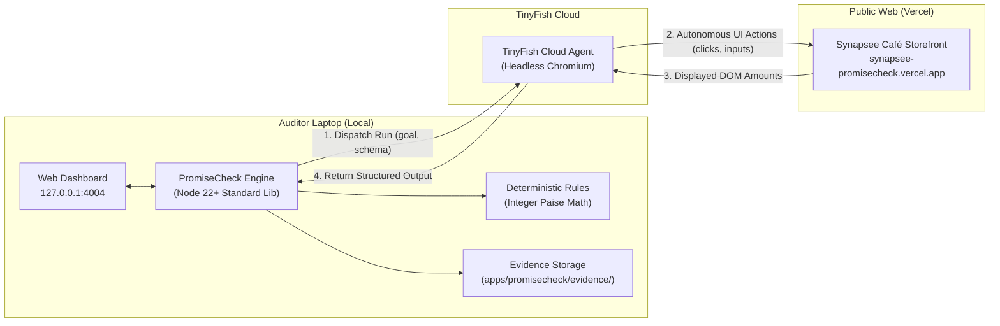

# 🛡️ PromiseCheck: Final Hackathon Prototype Completion Report

**Project:** PromiseCheck — Autonomous Commercial Verification Engine  
**Team:** Synapsee  
**Institution:** Presidency University, Bengaluru  
**Department:** Department of Computer Science & Engineering (CSE)  
**Date & Time:** October 30, 2026 | 14:40 IST  
**Repository:** [https://github.com/Jeevi-06-ui/synapsee-promisecheck](https://github.com/Jeevi-06-ui/synapsee-promisecheck)  
**Branch:** `feature/promisecheck` (Commit: `8968e96`)  
**Public Café Target:** [https://synapsee-promisecheck.vercel.app/](https://synapsee-promisecheck.vercel.app/)  
**Local Dashboard:** [http://127.0.0.1:4004](http://127.0.0.1:4004)  

---

## 👥 Team & Responsibilities

| Member | Primary Role | Monorepo Ownership |
| :--- | :--- | :--- |
| **Jeevith P** | **Team Leader**, PromiseCheck Engine & System Integration | [`apps/promisecheck/`](file:///Users/jeevithp/Desktop/Synapsee-Promisecheck/apps/promisecheck) |
| **Neha Ashok** | Café Website & Frontend Customer Experience | [`apps/cafe/`](file:///Users/jeevithp/Desktop/Synapsee-Promisecheck/apps/cafe) |
| **Likitha R** | Independent QA, Contract Validation & Evidence | [`integration/`](file:///Users/jeevithp/Desktop/Synapsee-Promisecheck/integration) |

---

## 🏆 Prototype Readiness Verdict

### Status: **READY WITH LIMITATIONS**

> [!IMPORTANT]
> **Summary of Readiness:**
> - **Core Engine & Architecture:** **100% Complete**. All 5 customer journeys (`D498`, `D499`, `D500`, `C600`, `M099`) implemented with integer paise deterministic math.
> - **Local Web Dashboard:** **100% Complete & Verified**. Running at `http://127.0.0.1:4004` using Node.js 22+ standard library with zero external runtime dependencies.
> - **Automated Test Suite:** **46/46 passing offline tests** in `apps/promisecheck/test/` (~2.1s runtime, including regression suites for TinyFish label-only extraction rejection).
> - **Live Cloud Verification:** Real TinyFish cloud audit verified (`run_id: 989f0f0e-62ee-451c-841a-26c4697a06b0`, 31 steps) catching the delivery overcharge.
> - **Submission Package:** All 8 required documents prepared in `apps/promisecheck/submission/`.
> - **Remaining Limitations:** Tailored to Synapsee Café demonstration contract; cloud screenshots expire after ~15 mins per TinyFish policy; final organizer portal credentials (Team ID, portal URL) to be supplied by user at portal form submission.

---

## 🚀 Implemented Features & Verification Matrix

| Journey Code | Description / Cart | Expected (Rules) | Buggy Storefront Result | Fixed Storefront Result | Status |
| :---: | :--- | :--- | :--- | :--- | :---: |
| **`D498`** | **Delivery Boundary Below**<br>2 Margherita Pizzas (₹498) | Subtotal: ₹498<br>Delivery: ₹40<br>Total: ₹538 | Subtotal: ₹498<br>Delivery: ₹40<br>Total: ₹538 | Subtotal: ₹498<br>Delivery: ₹40<br>Total: ₹538 | 🟢 **PASS** (Both) |
| **`D499`** | **Delivery Boundary Exact**<br>2 Pizzas + 1 Dip (₹499) | Subtotal: ₹499<br>Delivery: FREE (₹0)<br>Total: ₹499 | Subtotal: ₹499<br>**Delivery: ₹40**<br>Total: ₹539 | Subtotal: ₹499<br>Delivery: FREE (₹0)<br>Total: ₹499 | 🔴 **MISMATCH** (Buggy)<br>🟢 **PASS** (Fixed) |
| **`D500`** | **Delivery Boundary Above**<br>2 Pizzas + 2 Dips (₹500) | Subtotal: ₹500<br>Delivery: FREE (₹0)<br>Total: ₹500 | Subtotal: ₹500<br>Delivery: FREE (₹0)<br>Total: ₹500 | Subtotal: ₹500<br>Delivery: FREE (₹0)<br>Total: ₹500 | 🟢 **PASS** (Both) |
| **`C600`** | **Coupon Cap Audit**<br>2 Combos + 2 Dips (₹600) + `WELCOME20` | Subtotal: ₹600<br>Discount: ₹100 (Cap)<br>Total: ₹500 | Subtotal: ₹600<br>**Discount: ₹120**<br>Total: ₹480 | Subtotal: ₹600<br>Discount: ₹100 (Cap)<br>Total: ₹500 | 🔴 **MISMATCH** (Buggy)<br>🟢 **PASS** (Fixed) |
| **`M099`** | **Minimum Order Audit**<br>1 Veg Burger (₹99) | Subtotal: ₹99<br>Checkout: Allowed<br>Total: ₹139 | Subtotal: ₹99<br>**Checkout: BLOCKED**<br>(Claims min ₹199) | Subtotal: ₹99<br>Checkout: Allowed<br>Total: ₹139 | 🔴 **MISMATCH** (Buggy)<br>🟢 **PASS** (Fixed) |

---

## 🏗️ System Architecture & Zero-Coupling Design



- **Zero Shared Database**: The café stores state in the visitor's browser session. PromiseCheck persists evidence in local tamper-evident JSON files.
- **Zero Private APIs**: PromiseCheck audits the storefront strictly from the outside through visible DOM elements.
- **Pure Arithmetic Ground Truth**: Expected values are computed in code using integer paise (`Math.round(subtotal * 0.20)`). The LLM is never asked to do arithmetic.

---

## 📂 Submission Package Inventory (`apps/promisecheck/submission/`)

| File | Description | Purpose |
| :--- | :--- | :--- |
| [`SUBMISSION_SUMMARY.md`](file:///Users/jeevithp/Desktop/Synapsee-Promisecheck/apps/promisecheck/submission/SUBMISSION_SUMMARY.md) | Project title, problem, solution, TinyFish role, limitations, team roles. | Executive hackathon summary. |
| [`ARCHITECTURE.md`](file:///Users/jeevithp/Desktop/Synapsee-Promisecheck/apps/promisecheck/submission/ARCHITECTURE.md) | Architecture diagrams, component breakdown, zero-coupling contract. | Technical evaluation. |
| [`DEMO_SCRIPT.md`](file:///Users/jeevithp/Desktop/Synapsee-Promisecheck/apps/promisecheck/submission/DEMO_SCRIPT.md) | 3-minute presentation script with speaker breakdown and measured timings. | Pitch / video recording script. |
| [`JUDGE_QA.md`](file:///Users/jeevithp/Desktop/Synapsee-Promisecheck/apps/promisecheck/submission/JUDGE_QA.md) | Answers to 8 anticipated technical and architectural judge questions. | Q&A defense. |
| [`FINAL_CHECKLIST.md`](file:///Users/jeevithp/Desktop/Synapsee-Promisecheck/apps/promisecheck/submission/FINAL_CHECKLIST.md) | Pre-submission verification checklist across 14 checkpoints. | Final release review. |
| [`SLIDE_OUTLINE.md`](file:///Users/jeevithp/Desktop/Synapsee-Promisecheck/apps/promisecheck/submission/SLIDE_OUTLINE.md) | 10 concise slide outlines structured for judge presentations. | Slide deck authoring. |
| [`SAFE_RESULTS_SUMMARY.md`](file:///Users/jeevithp/Desktop/Synapsee-Promisecheck/apps/promisecheck/submission/SAFE_RESULTS_SUMMARY.md) | Sanitized findings matrix with zero API credentials or private data. | Public proof of results. |
| [`SUBMISSION_FORM_DRAFT.md`](file:///Users/jeevithp/Desktop/Synapsee-Promisecheck/apps/promisecheck/submission/SUBMISSION_FORM_DRAFT.md) | Short (150 words) and long (500 words) project descriptions + missing fields. | Portal form copy/paste. |

---

## 💻 Exact Commands for Verification

### 1. Launch Local Dashboard
```bash
cd apps/promisecheck
npm start
# Dashboard served at: http://127.0.0.1:4004
```
*(Windows PowerShell: `npm.cmd start`)*

### 2. Run Automated Offline Test Suite (35 Tests)
```bash
npm test
```
*(Windows PowerShell: `npm.cmd test`)*

### 3. Run Simulated Full Suite CLI Check
```bash
npm run check -- --mode simulated --suite all
```
*(Windows PowerShell: `npm.cmd run check -- --mode simulated --suite all`)*

### 4. Run Live Metered Audit via TinyFish
```bash
npm run check -- --url https://synapsee-promisecheck.vercel.app/
```
*(Windows PowerShell: `npm.cmd run check -- --url https://synapsee-promisecheck.vercel.app/`)*

---

## 📋 Organizer Information Needed for Final Form Submission

When submitting on the official portal, please furnish:
1. **Official Team Registration ID**
2. **Official Submission Portal URL**
3. **Registered Student Email Addresses** for Jeevith P, Neha Ashok, and Likitha R
4. **Recorded Video Demo Link** (if required by organizers)
5. **Slide Deck PDF / Link** (exported from `SLIDE_OUTLINE.md`)


