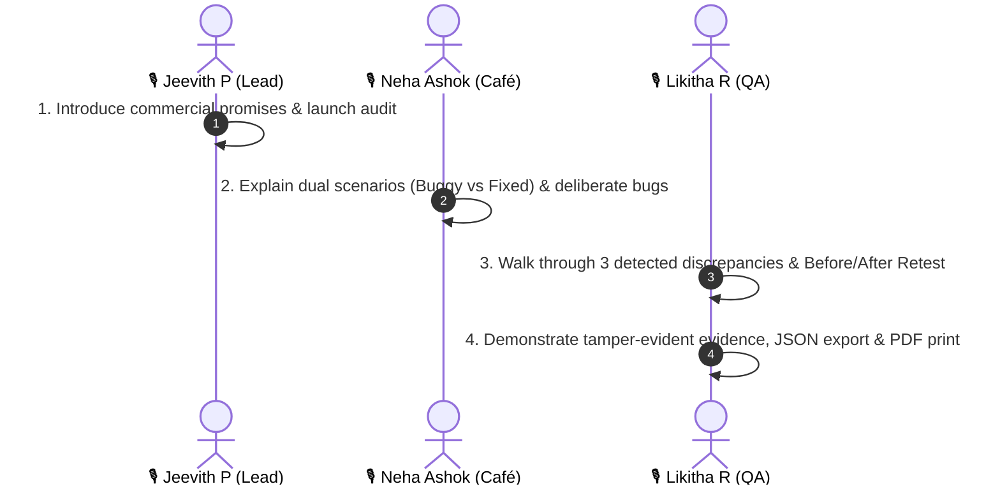

# PromiseCheck Live Hackathon Demo Guide

**Team:** Synapsee (Department of CSE, Presidency University, Bengaluru)  
**Speakers:** Jeevith P (Team Leader), Neha Ashok (Café Frontend), Likitha R (QA & Validation)  
**Target Café:** `https://synapsee-promisecheck.vercel.app/`  
**Local Dashboard:** `http://127.0.0.1:4004`  

---

## 🎬 Presentation Sequence (4-5 Minutes)

---

### Step 1: Jeevith P — The Commercial Promise & Starting the Audit (1 min)

1. **Opening Statement:**
   > *"E-commerce websites make explicit commercial commitments to customers every day: free delivery thresholds, promotional coupon caps, and no-minimum-order guarantees. But subtle software bugs often violate these promises without anyone noticing. PromiseCheck solves this by deploying TinyFish autonomous web agents to audit live storefronts like a real customer."*

2. **Dashboard Walkthrough (`http://127.0.0.1:4004`):**
   - Point out **System Readiness**: Node.js 22+, same-origin REST API, zero API key leakage.
   - Show **Card 1: Offer Review & Owner Confirmation**:
     - *"Before running any audit, the merchant or auditor confirms the exact rules: Free delivery at ₹499 (inclusive), standard delivery ₹40, coupon WELCOME20 capped at ₹100, and no minimum order amount."*
     - Click **💾 Confirm & Update Rules**.
   - Show **Card 2: Select Test Journeys**:
     - Point out the 5 journeys across delivery boundaries (₹498, ₹499, ₹500), coupon cap (₹600), and minimum order (₹99).
     - Select **Both (Buggy + Fixed Comparison)** scenario.
     - Click **🚀 Launch PromiseCheck Audit**.

---

### Step 2: Neha Ashok — The Café Demonstration Architecture (1 min)

1. **The Public Storefront (`https://synapsee-promisecheck.vercel.app/`):**
   > *"Synapsee Café is our customer-facing restaurant web application built with React and Tailwind CSS, hosted on Vercel. It supports two runtime modes controlled by URL parameters: `?scenario=buggy` and `?scenario=fixed`."*

2. **The 3 Deliberate Merchant Defects:**
   - **Defect 1 (Delivery Fee)**: In buggy mode, the code checks `subtotal > 499` instead of `>= 499`. At exactly ₹499, it charges ₹40 delivery instead of giving it free.
   - **Defect 2 (Coupon Cap)**: In buggy mode, `WELCOME20` awards an uncapped 20% discount (₹120 on a ₹600 cart) instead of strictly capping at ₹100.
   - **Defect 3 (Minimum Order Checkout Block)**: In buggy mode, it falsely demands a ₹199 subtotal, blocking checkout on a ₹99 Veg Burger.

3. **Autonomous Browser Interaction:**
   > *"TinyFish interacts purely through visible DOM elements: clearing the cart, incrementing item counters, applying coupons, and inspecting totals. There is no shared database or back-door calculation API."*

---

### Step 3: Likitha R — Findings, Evidence & Retest Comparison (2 mins)

1. **The 3 Discrepancies Flagged by PromiseCheck:**
   - In **Card 3: Audit Findings**, highlight the discrepancies:
     - 🔴 **Journey B (₹499)**: Delivery ₹40 charged instead of ₹0. Overcharge detected!
     - 🔴 **Journey D (₹600)**: Discount ₹120 applied instead of ₹100 cap. Discount-rule violation detected!
     - 🔴 **Journey E (₹99)**: Checkout blocked. Minimum order violation detected!
     - 🟢 **Fixed Scenario**: All 5 journeys pass with 100% compliance.

2. **Before / After Retest Comparison (Card 4):**
   - Scroll to **Card 4: Before & After Retest Comparison**:
     - Point out the side-by-side reconciliation table.
     - All 3 discrepancies transition to **CORRECTED IN FIXED SCENARIO**.

3. **Tamper-Evident Evidence & Exports (Card 5):**
   - Click **Evidence** drawer on any row to show the TinyFish Run ID, timestamps, and action log.
   - Click **📥 Export JSON** to show the downloadable compliance evidence.
   - Click **🖨️ Print Report** to demonstrate the clean printable PDF audit summary.

---

## 🛟 Recorded Backup Flow (Offline Failsafe)

If conference Wi-Fi or TinyFish cloud connectivity becomes unavailable during the presentation, use the recorded backup:

1. **Instant Offline Replay:**
   - In the dashboard, scroll down to **Card 5: Saved Audit Evidence History**.
   - Click **View** on the pre-recorded baseline run:
     `audit-2026-10-30...` or `delivery-2026-10-30T06-59-43-287Z.json`.
   - The dashboard instantly hydrates all findings, logs, and retest tables from historical evidence.
   - Clearly points out the persistent **RECORDED** provenance badge.

2. **Simulated Mode Demo:**
   - Toggle **Execution Mode** to **Simulated Mode**.
   - Notice the prominent badge: **SIMULATED — NOT A LIVE AUDIT**.
   - Click **Launch PromiseCheck Audit**: simulates the full multi-journey browser progression offline with zero credentials required.

