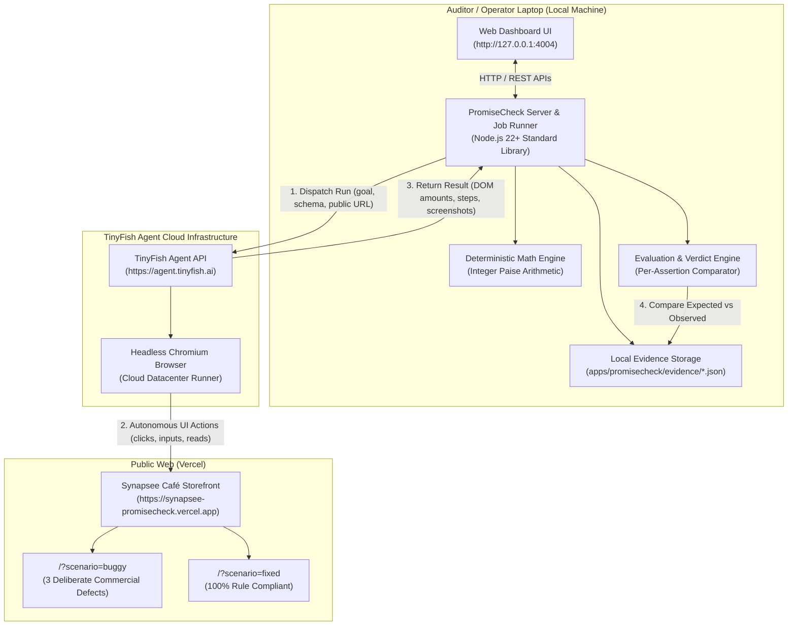
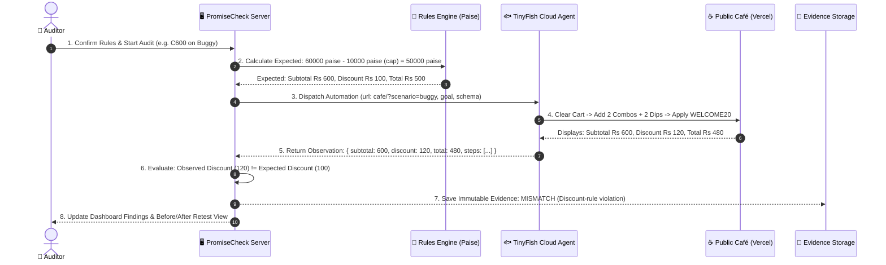

# PromiseCheck: System Architecture & Data Flow

**Team:** Synapsee | Presidency University, Bengaluru  
**Component:** `apps/promisecheck/submission/ARCHITECTURE.md`  

---

## 1. High-Level Architecture Diagram

---

## 2. Component Breakdown

### A. Public Café Storefront (`apps/cafe/`)
- **Host**: Deployed on Vercel at `https://synapsee-promisecheck.vercel.app/`.
- **Stack**: React, TypeScript, Tailwind CSS, Vite.
- **Role**: Serves as the black-box target storefront.
- **Dual Runtime Scenarios**:
  - `/?scenario=buggy`: Contains 3 deliberate merchant defects (strict `> 499` delivery threshold, uncapped coupon discount, rogue ₹199 minimum order block).
  - `/?scenario=fixed`: Fully compliant reference implementation honoring all published offers.
- **Zero Backdoor**: Does not expose privileged calculation endpoints, test fixtures, or shared database state to the auditor.

---

### B. TinyFish Remote Browser Agent
- **API Endpoint**: `https://agent.tinyfish.ai/v1/automation/run-async`.
- **Authentication**: `X-API-Key` passed strictly from the local backend process.
- **Browser Execution**: Runs inside TinyFish's cloud infrastructure using a real browser profile (`lite`).
- **Autonomous Capabilities**:
  - Locates UI elements using semantic descriptions, ARIA attributes, and visible text.
  - Clears existing cart state to ensure an unpolluted baseline.
  - Sequentially adds requested products, validating quantities between clicks.
  - Enters coupon codes and triggers validation buttons.
  - Extracts visible text amounts (`subtotalText`, `deliveryText`, `discountText`, `totalText`) and numeric rupee equivalents.
  - Halts before placing an order or entering payment details.
- **Reachability Constraint**: Because TinyFish operates remotely, target storefronts must be publicly accessible over HTTPS. TinyFish cannot connect to local machine loopbacks (`http://localhost`).

---

### C. Local PromiseCheck Engine & Dashboard (`apps/promisecheck/`)
- **Host**: Runs locally on the auditor's laptop (`http://127.0.0.1:4004`).
- **Stack**: Node.js 22+ standard library (`node:http`, `node:fs`, `node:crypto`, `node:timers`). No third-party npm dependencies.
- **Sub-modules**:
  1. `src/config.js`: Loads environment variables, validates URLs against SSRF/loopbacks, and redacts credentials.
  2. `src/rules.js`: Holds product definitions and computes deterministic expected totals in integer paise.
  3. `src/journeys.js`: Defines the 5 customer journeys (`D498`, `D499`, `D500`, `C600`, `M099`).
  4. `src/evaluator.js`: Validates evidence completeness and generates granular per-assertion verdicts (`PASS`, `MISMATCH`, `INCONCLUSIVE`).
  5. `src/job-runner.js`: Manages the background worker, single-audit concurrency lock, and incremental evidence persistence.
  6. `src/simulator.js`: Provides realistic offline browser step progression for simulated testing without credentials.
  7. `src/server.js`: Serves the accessible dashboard UI and same-origin REST APIs.
  8. `src/retest.js`: Reconciles side-by-side Before/After comparisons between buggy and fixed runs.

---

## 3. The Zero-Coupling Integration Boundary

A core design principle of PromiseCheck is complete decoupling:
- **No Shared Database**: The café stores state in the visitor's browser (`localStorage`/`sessionStorage`). PromiseCheck stores evidence in local JSON files. There is zero database replication or connection.
- **No Direct API Integration**: PromiseCheck does not invoke internal café routes or privileged calculation endpoints.
- **Pure Observation Model**: The audit reflects what a genuine customer sees in the browser DOM. If a merchant's UI shows ₹40 delivery fee, PromiseCheck reads ₹40 delivery fee.

---

## 4. Deterministic Evaluation Lifecycle

1. **Rule Confirmation**: The auditor confirms published terms (free delivery threshold, coupon percentages and caps, minimum order policy).
2. **Deterministic Calculation**: Expected subtotal, discount, delivery fee, and final total are computed via pure code using integer paise math.
3. **Execution**: TinyFish navigates to the public café scenario and extracts displayed values.
4. **Evidence Validation**: Observations are rejected if the cart was not cleared, if item quantities were altered, or if displayed text does not match numeric values.
5. **Comparison & Verdict**: Granular assertions evaluate each component. Any difference between expected and observed results yields an explicit discrepancy finding.
6. **Immutable Recording**: Evidence is written synchronously to local disk with unique run IDs, timestamps, and step references.

